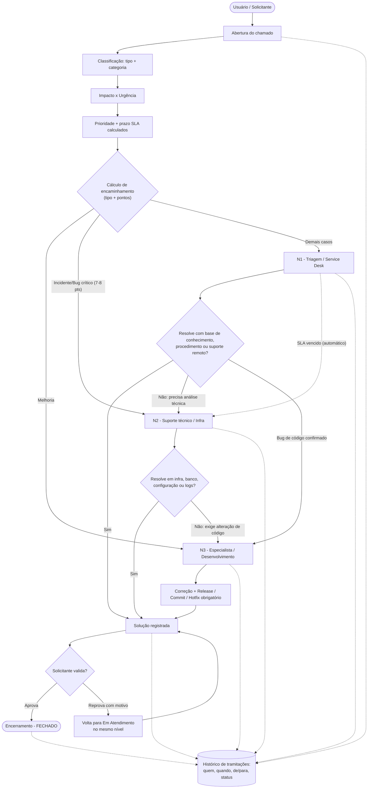

# Sistema de Gestão de Chamados – Documento Técnico (Equipe 3)

Software House que mantém aplicações web, APIs e bancos de dados para vários clientes.
Monolito **Spring Boot 3 + Spring Data JPA + Spring Security + Thymeleaf/Bootstrap 5 + MySQL**.

---

## 1. Arquitetura (resumo)

```
navegador ──HTTP──> Controllers (Thymeleaf) ──> Services (regras) ──> Repositories (JPA) ──> MySQL
                     │                          │
                     └ Spring Security (roles)  └ Job agendado (escalonamento automático)
```

| Camada | Classes principais |
|---|---|
| Entidades JPA | `Usuario`, `Perfil`, `Grupo`, `Categoria`, `Sla`, `Chamado`, `HistoricoChamado`, `ArtigoConhecimento` + enums `TipoChamado`, `Impacto`, `Urgencia`, `Prioridade`, `StatusChamado`, `AcaoHistorico` |
| Regras de negócio | `PrioridadeService` (matriz + SLA), `EncaminhamentoService` (cálculo do nível), `ChamadoService` (fluxo completo), `EscalonamentoAutomaticoJob`, `DashboardService` |
| Web | `ChamadoController`, `BaseConhecimentoController`, `DashboardController`, `HomeController` |
| Segurança | `SecurityConfig` (login por formulário, BCrypt, autorização por perfil) |
| Banco | `schema.sql` (DDL) e `data.sql` (seed com os 10 chamados) |

### Perfis
| Perfil | O que faz |
|---|---|
| `SOLICITANTE` | Abre chamados, acompanha os seus, comenta, autoriza suporte remoto, valida (aprova/reprova) a solução |
| `TECNICO` | Vê a fila do seu nível, assume, reclassifica, escala/transfere, faz suporte remoto, registra solução, mantém a base de conhecimento |
| `ADMINISTRADOR_SUPERVISOR` | Tudo do técnico em qualquer nível + encerramento direto de chamados solucionados + dashboard |

### Grupos / níveis
| Grupo | Escopo |
|---|---|
| **N1** – Service Desk | Triagem, dúvidas, acessos, procedimentos da base de conhecimento, suporte remoto simples |
| **N2** – Suporte técnico / Infra | Logs, banco de dados, servidores, integrações, configuração |
| **N3** – Especialistas / Desenvolvimento | Correção de bugs no código, melhorias e novas funcionalidades |

### Usuários de teste (senha `123456`)
| E-mail | Perfil | Nível |
|---|---|---|
| supervisor@softhouse.com | Supervisor | – |
| ana.n1@softhouse.com, bruno.n1@softhouse.com | Técnico | N1 |
| carla.n2@softhouse.com, gustavo.n2@softhouse.com | Técnico | N2 |
| daniel.n3@softhouse.com, eduardo.n3@softhouse.com | Técnico | N3 |
| joao@ / maria@alfavarejo.com.br, pedro@ / juliana@betalogistica.com.br, lucas@ / patricia@gamasaude.com.br, rafael@ / camila@deltaeducacao.com.br, thiago@epsilonfinanceira.com.br | Solicitante (9) | – |

---

## 2. Justificativa: sistema próprio em vez do GLPI

| Critério | GLPI | Sistema próprio (escolhido) |
|---|---|---|
| **Tempo** | Instalação rápida, mas exige tempo para configurar entidades, regras de negócio, SLAs, perfis e plugins e para entender o modelo de dados dele. | O escopo é pequeno e conhecido (10 fluxos); em Spring Boot as regras viram código direto, sem “lutar” contra configurações genéricas. |
| **Complexidade** | Ferramenta enorme (inventário, financeiro, contratos, projetos…) – a maior parte não seria usada e confunde a demonstração. | Só o que o enunciado pede: chamado, níveis, matriz de prioridade, SLA, histórico, base de conhecimento, remoto e dashboard. |
| **Manutenção** | Atualizações de versão podem quebrar plugins/customizações; customização em PHP fora do domínio da equipe. | Código Java da própria equipe, testável, versionado no Git; qualquer regra muda em um único `Service`. |
| **Flexibilidade** | Regras específicas (Referência de Release obrigatória no N3, autorização do solicitante antes do acesso remoto, matriz própria) exigiriam plugins ou adaptações. | Regras implementadas exatamente como especificado e explicáveis linha a linha na apresentação. |
| **Implantação** | Requer servidor PHP + Apache/Nginx + MySQL e configuração inicial via interface. | Um único `.jar` (Java 17) + MySQL; o banco e a massa de teste são criados automaticamente na subida. |

**Conclusão:** para uma operação grande e genérica o GLPI seria uma boa escolha. Para este projeto – escopo fechado, regras específicas de uma software house (N3 = desenvolvimento, rastreabilidade até o commit) e necessidade de demonstrar o domínio das regras – o sistema próprio é mais simples de entregar, de explicar e de manter.

---

## 3. Priorização e SLA

Pesos: Baixo/Baixa = 1 · Médio/Média = 2 · Alto/Alta = 3 · Crítico/Crítica = 4.
**Prioridade = soma dos pesos** → 2-3 BAIXA · 4 MÉDIA · 5-6 ALTA · 7-8 CRÍTICA.

| Impacto \ Urgência | Baixa | Média | Alta | Crítica |
|---|---|---|---|---|
| **Baixo** | Baixa | Baixa | Média | Alta |
| **Médio** | Baixa | Média | Alta | Alta |
| **Alto** | Média | Alta | Alta | Crítica |
| **Crítico** | Alta | Alta | Crítica | Crítica |

| Prioridade | SLA de solução |
|---|---|
| CRÍTICA | 2 h |
| ALTA | 8 h |
| MÉDIA | 24 h |
| BAIXA | 48 h |

**Alerta de prazo próximo:** quando um chamado pendente já consumiu **75%** do SLA da sua prioridade (Crítica: faltando 30 min · Alta: 2h · Média: 6h · Baixa: 12h; configurável em `app.sla.alerta-percentual`), os técnicos do nível (e de níveis acima) e o supervisor são avisados: sino com contador na barra superior, aviso flutuante, etiqueta “⚠ vence em…” nas listas, barra de prazo no chamado e a página *Alertas de prazo*. **SLA vencido – alerta geral:** quando o prazo estoura, **todos os técnicos (N1, N2 e N3) e o supervisor** são avisados, qualquer que seja o nível do chamado: faixa vermelha no topo de todas as telas, sino e aviso flutuante vermelhos. Uma verificação automática (a cada minuto) registra no histórico do chamado “SLA vencido – alerta enviado a toda a equipe: …” com o nome de cada pessoa avisada (uma vez por vencimento). Para demonstrar, o supervisor usa *Teste de prazos* para fazer um chamado “vencer em 30 min / 5 min” ou “vencido há 10 min” e depois restaurar o prazo original (tudo registrado no histórico).

Prazo = `data_abertura + horas do SLA` (tabela `sla`, editável no banco). Se o técnico reclassificar o chamado, prioridade e prazo são recalculados a partir da abertura.

---

## 4. Regras de encaminhamento e escalonamento

1. **Entrada (cálculo de encaminhamento):** o nível responsável é calculado na abertura pelo `EncaminhamentoService`, usando o tipo e os **pontos = peso do Impacto + peso da Urgência**:

   | Tipo | Pontos | Nível |
   |---|---|---|
   | Solicitação de Melhoria | qualquer | **N3** |
   | Dúvida / Solicitação de Serviço | qualquer | **N1** |
   | Incidente / Bug | 2 a 6 (Baixa, Média, Alta) | **N1** |
   | Incidente / Bug | 7 a 8 (Crítica) | **N2** – pula a triagem |

   Os limites ficam em `app.encaminhamento.pontos-n2` (padrão 7) e `app.encaminhamento.pontos-n3` (padrão 9 = desativado) no `application.properties`. A tela de abertura mostra o resultado do cálculo ao vivo, e o histórico registra o motivo (ex.: “8 pontos (4 impacto + 4 urgência) => N2”).
2. **Transferência manual:** técnico do nível atual (ou supervisor) escolhe o nível de destino e **informa justificativa obrigatória**. Subir = escalonamento; descer = devolução. Pode escolher **para quem** transferir: *qualquer técnico do nível* (vai para a fila) ou **um técnico específico** (também do mesmo nível, para passar a um colega). Quando há técnico escolhido, **só ele pode aceitar**; ele também pode **recusar com justificativa** e o chamado fica livre na fila do nível.
3. **Um chamado, um responsável:** dois técnicos nunca ficam com o mesmo chamado. Chamado que já tem responsável não pode ser assumido por outro técnico (só o supervisor redistribui). Se duas pessoas clicarem em “Assumir” ao mesmo tempo, o controle de versão do registro (`@Version`, coluna `versao`) faz só a primeira gravar; a segunda recebe o aviso de que o chamado acabou de ser alterado.
4. **Nível superior assume de nível inferior:** técnico do **N2** pode assumir chamados do **N1**, e técnico do **N3** pode assumir chamados do **N1 e do N2** que estejam na fila (sem responsável). O chamado sobe para o nível de quem assumiu e o histórico registra “Assumido por nível superior” (origem → destino, quem assumiu e o responsável anterior). O contrário não é permitido: N1 não assume chamado do N2/N3. As filas dos níveis abaixo ficam visíveis para o N2 e o N3 em *Minha fila*.
5. **N1 → N3 direto:** permitido quando o N1 já reproduziu um **bug de código** com evidência (ex.: chamado 2).
6. **Escalonamento automático:** a cada 5 minutos, chamados no **N1** ainda `ABERTO`/`EM_ATENDIMENTO` com **SLA vencido** são escalados para o **N2** (registrado no histórico com usuário “Sistema”).
7. **Encerramento no N3:** só é possível registrar a solução com a **Referência de Versão / Release / Commit / Hotfix** preenchida.
8. **Validação:** solução → `SOLUCIONADO`; o solicitante **aprova** (→ `FECHADO`) ou **reprova com motivo** (→ volta para `EM_ATENDIMENTO` no mesmo nível). O supervisor pode encerrar um chamado solucionado sem retorno do usuário.
9. **Suporte remoto:** técnico solicita → **solicitante autoriza** no chamado → técnico registra o log de diagnóstico. Sem autorização registrada, o sistema bloqueia o registro da sessão.

---

## 5. Fluxograma de atendimento



Status: `ABERTO` → `EM_ATENDIMENTO` → `SOLUCIONADO` → `FECHADO` (escalonamento devolve a `ABERTO` na fila do novo nível).
Status auxiliares: `AGUARDANDO_USUARIO` (técnico espera retorno; volta sozinho para Em Atendimento quando o solicitante comenta) e `CANCELADO` (duplicado / aberto por engano).

### Atualizar status (manual)
Técnicos do nível atual e o supervisor podem mudar o status pelo quadro **“Atualizar status”**, sempre com **justificativa obrigatória** registrada no histórico. Só são oferecidas as mudanças válidas:

| De | Para |
|---|---|
| Aberto | Em andamento · Cancelado |
| Em Atendimento | Aberto (devolver à fila) · Aguardando Usuário · Concluído (Solucionado) · Cancelado |
| Aguardando Usuário | Em andamento · Aberto · Concluído · Cancelado |
| Solucionado | Reabrir (Em Atendimento) · Fechado (sem validação do solicitante) |
| Fechado | Reabrir — **só supervisor** |
| Cancelado | Reativar (Aberto) — **só supervisor** |

“Concluído” segue as mesmas regras do registro de solução (a justificativa vira a solução; no N3 a release/commit é obrigatória).

---

## 6. Os 10 chamados de teste (carregados pelo `data.sql`)

| # | Chamado | Tipo | Imp. x Urg. → Prioridade | Caminho | Status final | Resultado / evidência |
|---|---|---|---|---|---|---|
| 1 | Erro 500 na aplicação web | Incidente | Alto x Alta → **Alta** (8h) | N1 | Em Atendimento | Ana (N1) aplicou KB #4 sem sucesso e está coletando evidências. |
| 2 | API retornando dados incorretos | Bug | Médio x Média → Média (24h) | N1 → **N3** | Em Atendimento | Bruno reproduziu o defeito e escalou direto ao N3; Daniel identificou a causa (PR #412). |
| 3 | Usuário sem acesso | Solicitação de Serviço | Médio x Média → Média | N1 | **Fechado** | Resolvido no N1 com o artigo **KB #1** (desbloqueio/senha) em 40 min. |
| 4 | Consulta lenta no banco | Incidente | Alto x Média → Alta | N1 → **N2** | Solucionado (aguarda validação) | Carla (N2) criou índice; consulta caiu de 38s para 0,4s. |
| 5 | Bug que afeta um cliente | Bug | Médio x Alta → **Alta** (médio-alta) | N1 | Aberto | Na fila do N1 aguardando triagem. |
| 6 | Bug crítico em vários clientes | Bug | Crítico x Crítica → **Crítica** (2h) | **N2** (cálculo: 8 pts) → **N3** | **Fechado** | Corrigido em 1h50 (dentro do SLA). Release: **Hotfix v3.4.1 – commit 8f2c1e9**. |
| 7 | Dúvida funcional | Dúvida | Baixo x Baixa → Baixa (48h) | N1 | **Fechado** | Respondida com o artigo **KB #3**. |
| 8 | Chamado com suporte remoto | Incidente | Médio x Média → Média | N1 | **Fechado** | Sessão AnyDesk **autorizada pela solicitante**; log de diagnóstico (PrintAgent parado + porta 9100 bloqueada) registrado. |
| 9 | Escalonamento N1 → N2 → N3 | Incidente | Alto x Alta → Alta | **N1 → N2 → N3** | **Fechado** | Rastreabilidade completa no histórico; 1ª solução reprovada pela usuária, 2ª aprovada. Release: **v2.8.3 – commit 4b7d2a1**. |
| 10 | Solicitação de nova funcionalidade | Solicitação de Melhoria | Baixo x Média → Baixa | **N3 direto** | Aberto | Encaminhada automaticamente ao desenvolvimento. |

Os chamados 1 a 9 (exceto o 6) entram no N1 pelo cálculo de encaminhamento; o 6 (8 pontos) entra direto no N2 e o 10 (melhoria) no N3.

Totais no dashboard após a carga: Aberto 2 · Em Atendimento 2 · Solucionado 1 · Fechado 5 · N1 5 · N2 1 · N3 4.

---

## 7. Respostas às perguntas do roteiro

**1. Por que escolheram sistema próprio?**
Porque o escopo é fechado e as regras são específicas da software house (N3 como desenvolvimento com registro obrigatório de release/commit, autorização do usuário antes do acesso remoto, matriz de prioridade própria). Em código, essas regras ficam exatas e explicáveis; no GLPI exigiriam configuração extensa e plugins, além de trazer muitos módulos que não seriam usados. A implantação também é mais simples: um `.jar` + MySQL, com a massa de teste criada automaticamente (detalhes na seção 2).

**2. Como a prioridade é definida?**
Pela matriz **Impacto x Urgência** (seção 3). O usuário informa os dois valores na abertura; o sistema soma os pesos e define BAIXA, MÉDIA, ALTA ou CRÍTICA, já calculando o prazo do SLA (48h, 24h, 8h ou 2h). O técnico pode reclassificar na triagem, e o recálculo fica registrado no histórico. Os mesmos pontos (impacto + urgência) também definem **em qual nível o chamado entra** (seção 4).

**3. Quando o N1 deve escalar para N2?**
Chamados críticos (7–8 pontos) já nem passam pelo N1: o cálculo de encaminhamento os envia direto ao N2. Para os demais, o N1 escala quando os procedimentos do N1 (base de conhecimento, orientação, desbloqueio, suporte remoto simples) não resolvem e o problema exige **análise técnica**: logs de servidor, banco de dados, desempenho, infraestrutura, integrações ou configuração. Também **automaticamente** quando o SLA vence ainda no N1. Bug de código já reproduzido pode ir direto ao N3.

**4. Quando o N2 deve escalar para N3?**
Quando a análise do N2 conclui que a causa está no **código-fonte** (bug, regressão de uma release, mudança de layout de integração que exige alteração no conector) ou quando é necessária uma **melhoria/nova funcionalidade**. Infra, banco e configuração são resolvidos no próprio N2.

**5. Como o usuário acompanha o chamado?**
Em **“Meus chamados”** ele vê status, prioridade, nível atual, responsável e prazo do SLA. Na tela do chamado ele vê a **linha do tempo completa** (cada atribuição, escalonamento, comentário e solução), pode comentar, autorizar acesso remoto e, ao final, aprovar ou reprovar a solução.

**6. Como o sistema evita perda de histórico?**
Toda ação passa pelo `ChamadoService`, que grava um registro em `historico_chamado` com **quem, quando, ação, nível de origem/destino e status anterior/novo**. A tabela é só de inserção (a aplicação não altera nem exclui), tem chave estrangeira para o chamado e ações automáticas também são registradas (usuário “Sistema”). Escalonamento exige justificativa e reprovação exige motivo, então o “porquê” também fica salvo.

**7. Como a solução fica documentada?**
No próprio chamado: descrição da causa/solução, **referência de versão/release/commit/hotfix** (obrigatória no N3), artigo da **base de conhecimento** utilizado e, quando houver, o **log de diagnóstico do suporte remoto**. Soluções recorrentes viram artigos na base de conhecimento, que técnicos podem criar e editar.

**8. Quais indicadores mostram se o suporte está funcionando?**
O dashboard mostra: chamados por **status**, por **prioridade**, por **categoria/tipo** e por **nível** (N1/N2/N3); e os indicadores de desempenho: **% resolvidos dentro do SLA**, **pendentes com SLA vencido**, **tempo médio de solução**, **% resolvidos no N1** e **quantidade de escalonamentos**. Muitos vencidos ou muito volume parado no N2/N3 indicam gargalo; alto % no N1 e SLA cumprido indicam um suporte saudável.

---

## 8. Modelo de dados

```
perfil (id, nome, descricao)
grupo (id, sigla, nome, descricao, nivel)
categoria (id, nome, descricao)
sla (prioridade PK, horas_solucao)
usuario (id, nome, email UK, senha BCrypt, empresa, perfil_id FK, grupo_id FK, ativo)
artigo_conhecimento (id, titulo, problema, solucao, palavras_chave, categoria_id FK, autor_id FK, data_criacao, data_atualizacao)
chamado (id, titulo, descricao, tipo, categoria_id FK, impacto, urgencia, prioridade, status,
         solicitante_id FK, grupo_atual_id FK, tecnico_id FK, tecnico_designado_id FK, versao, data_abertura, prazo_sla, data_solucao, data_fechamento,
         solucao, referencia_versao, artigo_id FK,
         suporte_remoto, remoto_autorizado, remoto_autorizado_em, remoto_ferramenta, remoto_diagnostico)
historico_chamado (id, chamado_id FK, usuario_id FK, data_hora, acao, grupo_origem_id FK, grupo_destino_id FK,
                   status_anterior, status_novo, descricao)
```
